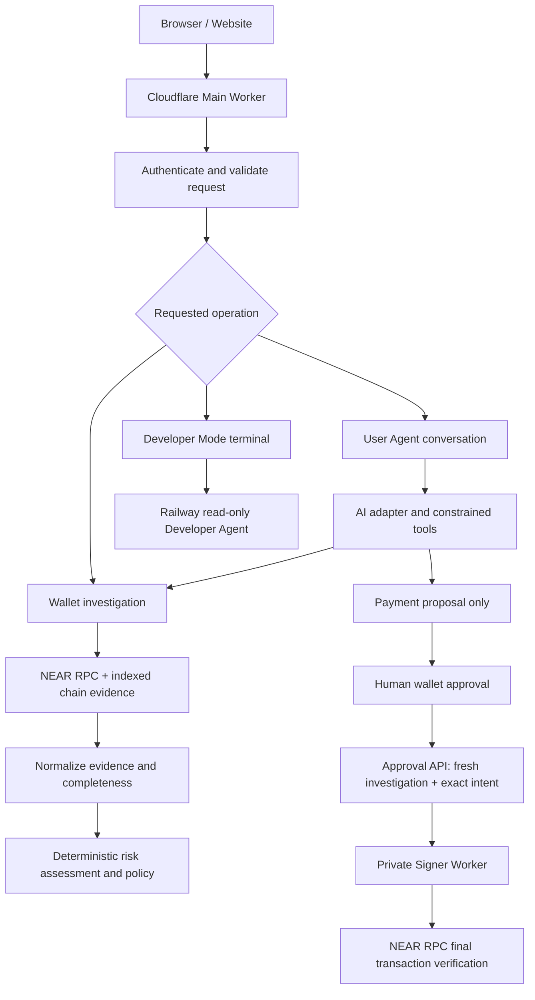

# Sentinel Core — Backend Architecture

**Status: implementation-oriented architecture note, 13 November 2026.** This document describes the code paths behind the Sentinel website. It distinguishes implemented runtime behavior from optional integrations and features that are not yet enabled.

## 1. What “Sentinel Core” means

Sentinel Core is the server-side security and orchestration layer. It is not the chat window, the model, or the website's visual interface. The browser submits requests to the Cloudflare Main Worker; the Main Worker authenticates and validates them, invokes the relevant investigation/agent/policy path, persists state, and—only for the payment approval path—communicates with the isolated Signer Worker.

The core is designed around one rule:

> AI may interpret and propose. Deterministic Sentinel code evaluates evidence and policy. The wallet owner authorizes the exact transaction. The isolated signer independently verifies the result.

## 2. Runtime components

| Component | Responsibility | Important source |
|---|---|---|
| Website / browser | UI, wallet connection, authenticated requests, display of findings and approval prompts | `public/` |
| Cloudflare Main Worker | Main API boundary, route dispatch, request limits, rate limiting, security headers, Turnstile checks, telemetry attempt | `src/index.js`, `src/http-security.mjs` |
| Investigation engine | NEAR account state and indexed chain evidence collection, normalization, pagination, completeness tracking, risk factors | `functions/api/investigate.js`, `functions/api/_shared.js` |
| Deterministic policy | Validates payment intent and decides whether an action may proceed | `src/agent-policy.mjs` |
| AI adapter | Normalizes model responses and bounded tool calls; AI output is treated as untrusted | `functions/api/_ai.js` |
| User Agent | Conversation, read-only investigation tool, and explicit payment-proposal tool | `functions/api/agent.js` |
| Approval API | Rechecks policy and investigation, binds approval to exact intent, calls signer through private binding | `functions/api/agent-approve.js` |
| Isolated Signer Worker | Independently verifies request authentication, replay state, approval, limits, transaction evidence and final NEAR RPC result | `signer-worker/src/index.mjs` |
| Developer Mode session API | NEP-413 challenge verification and D1-backed application-session lifecycle | `functions/api/developer-session.js` |
| Railway terminal runtime | Developer Agent session validation and deterministic read-only planning | Railway service `sentinel-terminal-runtime`; source is managed in Railway |
| D1 databases | Investigation ownership, audit, approvals, sessions, and signer-side execution/replay records | `migrations-d1/`, `signer-worker/migrations/` |

Hatchable's Runtime Agent / Security Supervisor is an external control-plane and telemetry integration. It is not the authoritative payment-policy engine and must not be treated as a synchronous approval dependency. Production telemetry forwarding is separately documented and must not be described as live until delivery is verified.

## 3. Main request path

The diagram shows logical paths, not a promise that every path runs on every request. A normal conversation does not automatically initiate an investigation or payment. Tools are invoked only when the request and the server-side tool contract allow them.

## 4. Investigation engine — the security brain

The investigation endpoint accepts a NEAR account identifier and optional sender/amount context. It obtains account state from the configured NEAR RPC and indexed evidence from NearBlocks. The code normalizes:

- native transaction history and transaction outcomes;
- receipt history and receipt outcomes;
- fungible-token transfer events;
- contract code-hash observations when available;
- timestamps, signer/receiver direction, status, and source pagination metadata.

The engine tracks whether each evidence source is complete and whether provider schemas were recognized. It caps page traversal and uses bounded network timeouts/retries. If a provider is unavailable, a schema is unrecognized, or pagination remains incomplete, the response carries evidence limitations; absence of evidence is not treated as proof of safety.

Risk signals include observed transaction/receipt/FT patterns and the repository's deterministic heuristics. A first-seen indexed activity timestamp is an indexed-history proxy, **not proof of account creation age**. A contract code-hash comparison is limited to available prior Sentinel observations; it is not a universal malware verdict.

The investigation produces structured evidence and a deterministic decision. AI review, when requested and configured, may explain supplied evidence but must not rewrite the decision. The AI prompt explicitly forbids inventing history, ownership, exploit details, or malicious intent.

## 5. Deterministic policy and AI boundary

The AI adapter in `functions/api/_ai.js` converts messages and tool calls to the configured Cloudflare AI runtime model interface, limits tool calls, bounds output tokens, and applies a timeout. The default model identifier in source is `@cf/zai-org/glm-4.7-flash`; a valid `SENTINEL_AI_MODEL` can override it.

The User Agent exposes a constrained tool surface, including:

- `investigate_near_account` — server-side read-only investigation;
- `request_near_payment` — creates a payment proposal only after an explicit user request.

The model's response is not a trusted security decision. The backend validates tool arguments, payment receiver and amount, authenticated actor, idempotency key, and policy. The deterministic policy and the fresh investigation remain authoritative. Prompt text, wallet metadata, transaction memos, and model output cannot disable those checks.

## 6. User Agent payment path

The current native NEAR payment path is implemented in source as a proposal-and-wallet-approval workflow, but the branch Wrangler kill switch is set to fail closed. Do not expect payment proposals to proceed until a reviewed Testnet release deliberately enables the main and signer kill switches together. When enabled for controlled testing:

1. The authenticated User Agent receives a clear request to create a payment proposal.
2. The backend validates receiver and amount and stores an actor-bound pending proposal with a short expiry.
3. The user explicitly selects the wallet approval action for that exact receiver and amount.
4. The approval API verifies ownership/actor binding and expiry, performs a fresh trusted investigation, and evaluates deterministic authorization policy.
5. The browser wallet signs and broadcasts the exact native NEAR Transfer. Sentinel does not take the user's seed phrase or private key.
6. The Main Worker calls the isolated Signer Worker through the `SIGNER_SERVICE` service binding, authenticated with timestamp, nonce, and HMAC-SHA256. The current branch config disables the Signer's public `workers.dev` endpoint.
7. The Signer Worker independently checks request authentication, replay/idempotency state, approval claim, spend policy and kill switch, then queries NEAR RPC to verify the submitted transaction and successful exact transfer. It does not sign or broadcast the user's native Transfer.
8. If the final result cannot be established, the system must preserve an unknown/conservative status rather than claim success.

The payment-contract source and restricted FunctionCall-key validator in the repository are not proof that the current native payment route uses a deployed contract. The current native payment verification path checks the wallet-signed Transfer. The helper `assertRestrictedFunctionCallKey()` is not called by the active Signer `execute()` path. Do not describe this as a contract-scoped payout unless a configured deployed contract and matching transaction evidence exist.

## 7. Developer Mode path

Developer Mode is separate from User Agent payment execution:

1. The signed-in user requests a one-use challenge for a NEAR Testnet account.
2. The wallet signs a NEP-413 message that states the authorization is for an application session only.
3. The Main Worker verifies the signature against NEAR Testnet RPC and binds it to the authenticated actor, account, recipient/origin, nonce and expiry.
4. The system creates an eight-hour D1-backed application session. The browser receives an HttpOnly, Secure, SameSite=Strict cookie; only a SHA-256 token hash is stored.
5. Production forwards the session cookie to Railway. Railway revalidates the session with Production and checks the requested wallet account.
6. The Developer Agent returns deterministic read-only planning output.

This application session is **not** a NEAR FunctionCall access key. The current Railway planner does not fetch live DEX quotes, create executable orders, sign, or broadcast swaps or payments. `execution_enabled` remains `false`. Session revoke invalidates the application session; there is no on-chain key to delete in this release.

Explicit native NEAR payment prompts are deliberately routed back to the existing User Agent proposal flow, even if Developer Mode is active. This preserves the wallet's **Approve payment** step.

See [Developer Mode Readiness](DEVELOPER_MODE_READINESS.md) for deployment evidence and uncompleted acceptance checks.

## 8. Storage and trust boundaries

- Main D1 stores application records such as investigation ownership, audit events, pending approvals, and Developer Mode sessions.
- The Signer Worker has its own D1 ledger for nonce/replay claims and execution/spend state.
- Privy identity authenticates the application actor; it is not a NEAR wallet signature.
- NEP-413 proves wallet-message authorization for the Developer Mode application session; it is not a transaction signature.
- The connected NEAR wallet signs the actual native transfer.
- The Signer Worker is an independent verifier/enforcement boundary, not an AI agent.
- Railway Developer Agent is a separate read-only planning runtime; it does not receive wallet private keys.
- Hatchable telemetry is advisory. It must never be allowed to override a local policy decision or authorize signing.

## 9. Fail-safe behavior

The core should fail closed for sensitive actions when authentication, evidence completeness, policy, approval state, signer binding, RPC verification, or kill-switch state is missing or unknown. In particular:

- incomplete investigation is not a clean `ALLOW`;
- expired, replayed, mismatched or reused approvals are rejected;
- unknown signer outcomes are not displayed as successful payments;
- unavailable AI must not disable deterministic checks;
- Developer Mode session activation must wait for backend signature verification;
- Developer Mode planning must never be represented as transaction execution.

## 10. Source map and maintenance

| Concern | Source / tests |
|---|---|
| Main Worker routing and request boundary | `src/index.js`, `src/http-security.mjs` |
| Investigation and evidence normalization | `functions/api/investigate.js`, investigation tests |
| Risk and payment policy | `src/agent-policy.mjs`, policy tests |
| AI adapter and User Agent | `functions/api/_ai.js`, `functions/api/agent.js` |
| Human approval | `functions/api/agent-approve.js` |
| Signer enforcement | `signer-worker/src/index.mjs`, signer tests |
| Developer Mode session | `functions/api/developer-session.js`, `migrations-d1/0010_developer_sessions.sql` |
| Railway planning boundary | Railway service source and `tests/developer-mode-boundary.test.mjs` |
| Release verification | `docs/END_TO_END_VERIFICATION.md`, `docs/DEVELOPER_MODE_READINESS.md` |

When code changes, update this document only when the corresponding implementation and tests support the new behavior. Keep historical deployment evidence in the verification report rather than duplicating stale version numbers throughout the README.
